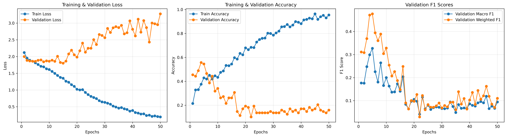
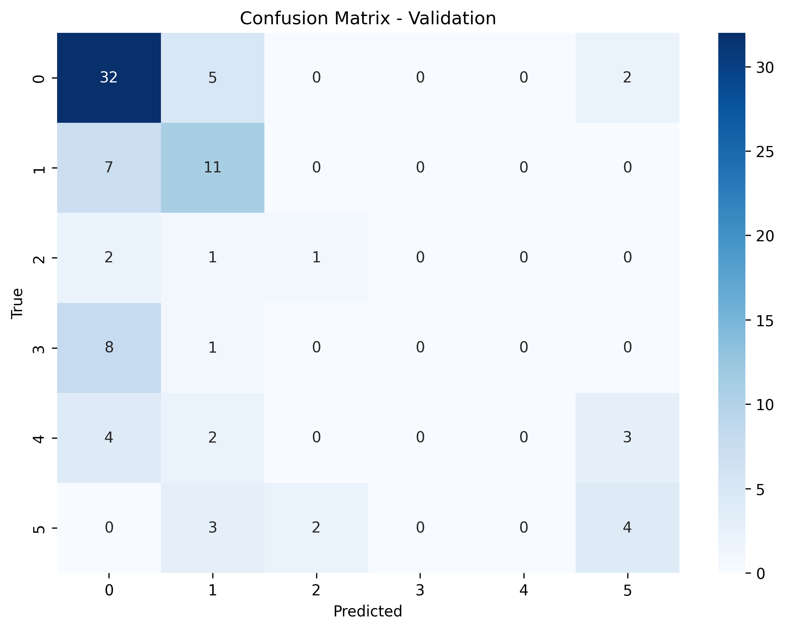
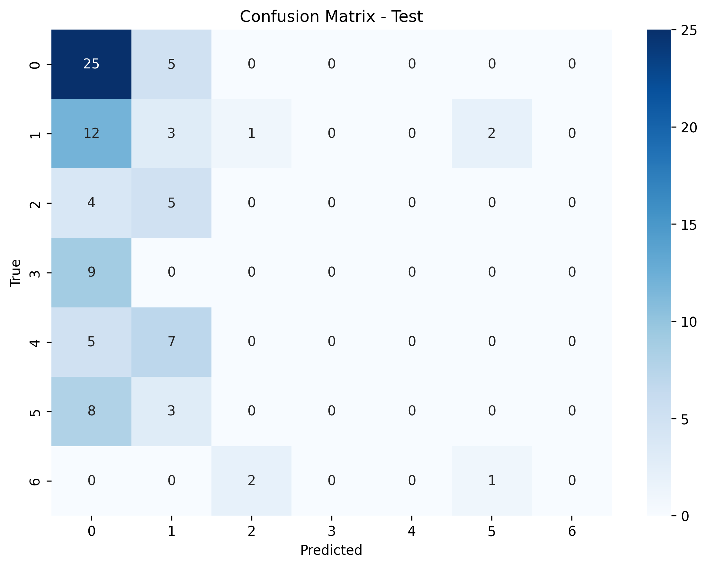

# EEG Brain Age Group Classification

A deep learning project for classifying age-related groups from resting-state electroencephalography (EEG) recordings using Mel spectrograms and a CNN–BiLSTM architecture.

## Overview

This project investigates age-group classification from resting-state EEG data using the **LEMON dataset**. EEG recordings are processed into Mel spectrogram representations, which are used as inputs to a deep learning model combining convolutional neural networks (CNNs) and a bidirectional long short-term memory network (BiLSTM).

The task is formulated as a nine-class classification problem using the age-label mapping implemented in the project code.

The project covers EEG data preparation, feature extraction, participant-level data splitting, model training, and evaluation.

## Methodology

The experimental pipeline consists of the following steps:

1. Load participant metadata and construct age-related labels.
2. Discover EEG recordings and identify common EEG channels.
3. Divide recordings into fixed-duration EEG segments.
4. Convert EEG segments into Mel spectrogram representations.
5. Split the data by participant to prevent subjects from appearing across multiple data splits.
6. Train a CNN–BiLSTM classifier.
7. Evaluate model performance using classification metrics and confusion matrices.

### Model Architecture

The model consists of three main components:

- **Shared CNN:** Extracts spatial and spectral patterns from the Mel spectrogram representations.
- **Bidirectional LSTM:** Models sequential relationships between EEG segments.
- **Classification layer:** Produces predictions for the nine age-related classes.

The implementation, architecture details, and training configuration are available in `src/eeg_brain_age/`.

## Results

The repository includes visualizations generated during model training and evaluation.

### Training Curves



### Validation Confusion Matrix



### Test Confusion Matrix



For the exact evaluation metrics, class-level results, and experimental configuration, refer to the notebook and evaluation outputs.

## Repository Structure

```text
eeg-brain-age/
├── README.md
├── requirements.txt
├── .gitignore
├── notebooks/
│   └── brain_age_experiment.ipynb
├── reports/
│   └── figures/
│       ├── training_curves.png
│       ├── validation_confusion_matrix.png
│       └── test_confusion_matrix.png
└── src/
    └── eeg_brain_age/
        ├── __init__.py
        ├── data.py
        ├── dataloaders.py
        ├── dataset.py
        ├── evaluation.py
        ├── features.py
        ├── models.py
        ├── splits.py
        ├── training.py
        └── visualization.py
```

## Requirements

- Python 3.10 or newer is recommended.
- Dependencies are listed in `requirements.txt`.
- PyTorch should be installed with a build compatible with your hardware and CUDA requirements.

### Installation

Clone the repository:

```bash
git clone https://github.com/AmirrezaGholizadeh/eeg-brain-age.git
cd eeg-brain-age
```

Create and activate a virtual environment.

**Windows:**

```bash
python -m venv .venv
.venv\Scripts\activate
```

**Linux or macOS:**

```bash
python -m venv .venv
source .venv/bin/activate
```

Install the dependencies:

```bash
python -m pip install --upgrade pip
python -m pip install -r requirements.txt
```

For GPU training, install a PyTorch build compatible with your hardware and CUDA environment by following the official [PyTorch installation guide](https://pytorch.org/get-started/locally/).

## Dataset and Configuration

This project uses EEG recordings and participant metadata from the LEMON dataset.

The raw EEG recordings and metadata are **not included in this repository**. Obtain the data through the appropriate official distribution and comply with its access conditions and data-use requirements.

Before running the experiment:

1. Obtain access to the required EEG recordings and participant metadata.
2. Configure the dataset and metadata paths in the notebook.
3. Ensure that the required files are accessible from your execution environment.

The notebook was developed in Google Colab and currently uses environment-specific Google Drive paths. These paths must be updated when running the project in another environment.

## Running the Experiment

Open the notebook:

`notebooks/brain_age_experiment.ipynb`

Configure the dataset paths and make sure the required data are accessible before executing the cells in order.

The notebook uses the modules in `src/eeg_brain_age/` for data preparation, feature extraction, data splitting, model definition, training, evaluation, and visualization.

## Outputs

Depending on the experiment configuration, the workflow can generate:

- A trained model checkpoint.
- Training and validation curves.
- Classification metrics and class-level evaluation reports.
- Validation and test confusion matrices.

Generated caches, raw EEG files, and model checkpoints are excluded from version control by the current `.gitignore` configuration.

The figures included in `reports/figures/` are provided for inspection of the experimental results.

## Reproducibility

Results may vary depending on the dataset version, participant selection, data-splitting configuration, software versions, random seeds, and training settings.

Refer to the notebook and source modules for the implementation and configuration used in the experiment.

The presence of code and result visualizations does not, by itself, establish independent reproducibility or clinical validity.

## Limitations

This project is intended for research, educational, and portfolio purposes. Age-group classification from EEG is an experimental machine learning task and should not be interpreted as a clinical diagnostic tool.

The model's performance and generalizability depend on the dataset, participant distribution, preprocessing choices, and evaluation protocol.

## License

No license has been specified for this repository yet. Before selecting a code license or redistributing any dataset-related material, review the applicable dataset terms and permissions.
